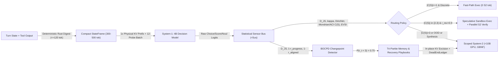

# CHAIN — Conformal Heterogeneous Agent Inference Network

> **Self-contained local-first Rust agent runtime** pairing an open **4B System-1 Decision Model** (`AgentDecision-4B` / `Vev-4b` Jev-style `Choice`/`Score`/`Noul`) with a **`<10B` System-2 LLM** (`Qwen2.5-7B` / `Qwen3-8B` / `Llama-3.1-8B`), connected via a closed-loop **Statistical Sensor Bus**, **Speculative `ReversibleTool` Sandbox**, and **BOCPD Context-Rot State Healing**.

---

## Architecture Overview

---

## Phase 0 — Crate & Inference Foundation
- [x] **0.1 Workspace & `Cargo.toml` Setup:**
  - Dependencies: `tokio` (`rt-multi-thread`, `macros`, `sync`), `tokio-util` (`CancellationToken`), `axum`, `serde`, `serde_json` (`raw_value`), `bytes`, `smallvec`, `rustc-hash`, `uuid` (`v7`), `statrs`, `rand`, `reflink-copy`, `rusqlite` (`bundled`), `core_affinity`, `async-trait`, `tracing`, `thiserror`, `toml`.
  - Feature-gated `llama-cpp-2` backend (with a clean `InferenceBackend` trait so unit/integration tests and mock/HTTP fallback run anywhere even without a local GGUF model, while production uses embedded `llama-cpp-2`).
- [x] **0.2 `src/config.rs`:**
  - Parse `config/runtime.toml` (`--decision-device cpu|gpu`, physical P-core pinning, `q8_0` KV cache, EVSI cost parameters, ACI learning rate $\gamma$, BOCPD hazard rate) and `config/calibration.json` (Mondrian per-group quantiles $\hat{q}_{1-\alpha}^{(g)}$).
- [x] **0.3 `src/engine/` (Inference Abstraction + `llama-cpp-2` & Mock/HTTP Backends):**
  - `DecisionBackend` trait: `prefill_and_probe_batch(prefix, frame, probes) -> ProbeLogitsBatch` (extracts target choice token IDs only, avoiding full-vocab softmax).
  - `GeneratorBackend` trait: `generate_scoped(slot, prompt, grammar, abort_flag) -> Result<String, AbortError>` with `Arc<AtomicBool>` cancellation and `excise_kv_range(pos_clean, pos_t)` for in-place Module E pruning.
  - Dedicated OS worker thread pools (`sys1-infer`, `sys2-infer`) bridged to `tokio` via bounded `mpsc`/`oneshot` channels.

---

## Phase 1 — Token-Budgeted `StateFrame` & Discrete Action Builder
- [x] **1.1 `src/probes/digest.rs` (Deterministic `sensor_digest`):**
  - Zero-LLM extractors capping every tool output at `<= 120` tokens:
    - *File/Patch:* unified diff header, `+/-` counts, `sha256[..8]`, changed symbol names.
    - *Shell/Test:* exit code, `error[` / `FAILED` / `panicked at` / `file:line` anchor extraction, bounded head/tail truncation.
    - *SQL:* row count, column names, first 3 rows (40 chars/col max).
- [x] **1.2 `src/probes/state_frame.rs` (`StateFrame`):**
  - Tier 0 Static Prefix: System instructions + frozen Goal $G$ + compact tool index.
  - Tier 1 Dynamic Delta (~150–250 tokens): Bracketed key-value state + last 3 `(action, sensor_digest)` pairs + dynamic $\mathcal{A}_t$.
- [x] **1.3 `src/probes/actions.rs` (Dynamic Candidate Set $\mathcal{A}_t$):**
  - Control-Flow Meta-Actions: `DONE`, `ROLLBACK_LAST`, `PRUNE_NOW`, `ASK_USER`.
  - Entity-Bound Actions: deterministically extracted file paths / test names / tx IDs bound directly to tools (`read_file(path)`, `run_test(name)`).
  - Scoped Synthesis Slots: `PATCH_FILE(path)`, `GEN_TOOL_ARGS(tool)`, `WRITE_SHELL_CMD`.
  - Explicit `ESCALATE_SYSTEM2` abstention option.
- [x] **1.4 `src/probes/templates.rs` (12-Probe Orthogonal Matrix):**
  - $P_{\text{fwd}}$ (Direct Selection), $P_{\text{inv}}$ (Inverse Exclusion), $P_{\text{pert}}^{(1..3)}$ (3 Paraphrased/Reordered Framings), and $P_{\text{rubric}}$ (`r_precond`, `r_reversible`, `r_progress`, `r_aligned`, `r_info_missing`, plus `Score` severity).

---

## Phase 2 — Statistical Sensor Bus (`< 5 µs` Zero-Alloc Hot Path)
- [x] **2.1 `src/stats/dirichlet.rs`:**
  - Fixed-size stack arrays (`[f64; 16]`) / `SmallVec` math (zero heap allocations).
  - Mean Jensen-Shannon Divergence $D_{\text{JS}}(P_{\text{fwd}}, P_{\text{pert}}^{(1..3)})$.
  - Forward-inverse consistency $\kappa$ and contradiction flag ($\arg\max P_{\text{fwd}} == \arg\max P_{\text{inv}}$).
  - Dirichlet evidence aggregation $\alpha_i = 1 + \sum_m w_m P^{(m)}(a_i)$ with correlated-probe weight cap, posterior mean $\hat{p}_i$, and epistemic uncertainty $U_{\text{ep}}$.
- [x] **2.2 `src/stats/conformal.rs` (Mondrian + ACI + Martingale Drift):**
  - **Mondrian Conformal:** Per-tool-group quantiles $\hat{q}_{1-\alpha}^{(g)}$ (`pure_read`, `fs_mutate`, `shell`, `network_api`) with small-sample shrinkage to global quantile.
  - **Adaptive Conformal Inference (ACI):** Online $\alpha_{t+1} = \text{clip}(\alpha_t + \gamma(\alpha - \text{err}_t), \alpha_{\min}, \alpha_{\max})$ over a pre-allocated `[f64; 200]` sliding window (`select_nth_unstable_by`).
  - **Conformal P-Values + Capped Martingale / Fisher $\chi^2$ Drift Test:** Detects domain/calibration shift.
- [x] **2.3 `src/stats/routing.rs` (EVSI / Bayes-Risk + SPRT + Online Priors):**
  - **EVSI / Bayes-Risk Routing:** Combines `Choice` ($\hat{p}$), `Score` expected severity ($\bar{L}$), and `Noul` ($p_{\text{rev}}$, $p_{\text{info\_missing}}$) to pick `FastPath` vs. `Speculative` vs. `System2` vs. `AskUser`.
  - **Online Conjugate Priors:** Discounted Beta-Binomial tool reliability $\hat{\mu}_{\text{tool}}$ + Hedge multiplicative probe weights $w_m$ + online Platt temperature scaling.
  - **SPRT Early Stopping & Thompson Sampling:** 2-stage probe batching / hopeless-retry abort + Beta Thompson Sampling over $C(S)$ during sandbox recovery.

---

## Phase 3 — Tri-Partite Memory, Scoped System-2 & BOCPD State Healing
- [x] **3.1 `src/stats/bocpd.rs`:**
  - Bayesian Online Changepoint Detection (Adams & MacKay, Student-t conjugate prior) over $x_t = [D_{\text{JS}}(t), 1 - P(\text{r\_progress}_t), 1 - P(\text{r\_aligned}_t)]$.
  - Trigger condition: $P(r_t < 3) > 0.75$.
- [x] **3.2 `src/memory/working_state.rs` (Tri-Partite Memory — Zero-LLM Summarization):**
  - Deterministic `WorkingState` (frozen `goal` + `invariants`, overwriting `artifact_index`, `tx_id`-keyed `verified_facts`, `active_blockers`).
  - `DeadEndLedger` (bounded list of failed `(action_sig, target, error_sig)` negative constraints).
  - Ephemeral Turn Ring Buffer ($k = 2$) + `CleanCheckpoint` snapshots.
- [x] **3.3 `src/memory/pruner.rs` & Recovery Playbooks:**
  - 4 deterministic playbooks: (1) Soft State-Diff Reset, (2) `tx_id` Rollback + Counterfactual Hint, (3) Read-Only Scope Narrowing, (4) Goal Re-Anchoring.
  - Scoped System-2 prompt builders (`SPECULATIVE_VERIFY`, `GEN_TOOL_ARGS`, `PATCH_TARGET`, `ESCALATE`) with slot partitioning (`slot 0` vs `slot 1`).

---

## Phase 4 — Speculative `ReversibleTool` Sandbox & Runtime Proxy
- [x] **4.1 `src/sandbox/traits.rs`:**
  - `ReversibleTool` trait with typed `ToolArgs` / `Box<serde_json::value::RawValue>` (zero `serde_json::Value` on hot path), `RiskGroup`, `is_pure_read()`, `execute(args, tx_id)`, and `rollback(tx_id)`.
- [x] **4.2 `src/sandbox/fs_tools.rs` & `src/sandbox/sqlite_tool.rs`:**
  - O(1) filesystem snapshots via `reflink-copy` (falling back to `hard_link` + atomic `rename` on ext4) keyed by `Uuid::now_v7()`.
  - Shell tool isolation hook (OverlayFS / temp shadow workspace fallback).
  - SQLite WAL actor with `SAVEPOINT tx_<id>` / `ROLLBACK TO` / `RELEASE`.
- [x] **4.3 `src/runtime.rs` & `src/main.rs`:**
  - Speculative race (`tokio::select!` + `CancellationToken` + `AtomicBool` abort) running `tool.execute` in parallel with System-2 `SPECULATIVE_VERIFY`.
  - OpenAI-compatible HTTP proxy (`axum` `/v1/chat/completions` + `/health` + `/metrics`).

---

## Phase 5 — Calibration, Benchmarks & Verification
- [x] **5.1 `eval/calibrate.rs` (or CLI subcommand `chain calibrate`):**
  - Generates `config/calibration.json` with Mondrian per-group quantiles from held-out trajectories.
- [x] **5.2 `eval/bench_harness.py`:**
  - Tier 1: `TAU-bench` (`pass^1`–`pass^5`), `BFCL v3` (Multi-Turn & Irrelevance abstention F1), and deterministic **40-Turn Context-Rot Needle** generator.
  - Tier 2: `Terminal-Bench` + scoped `SWE-bench Lite` subset.
  - Baselines: Raw `<10B`, `<10B` + Naive Single-Shot System-1 Router (`P_fwd` only), full module ablations, and 70B reference.
- [x] **5.3 Full Test Suite:**
  - Unit tests for `stats/` (`dirichlet`, `conformal`, `routing`, `bocpd`), `probes/` (`digest`, `state_frame`, `actions`), `memory/`, `sandbox/` (rollback verification), and end-to-end `runtime` simulation tests with a deterministic mock System-1/System-2 backend.
